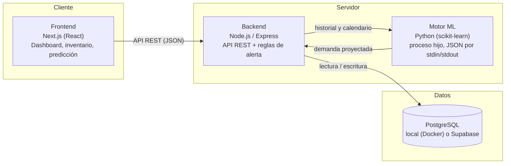

# NexuStock

Sistema inteligente de gestión y predicción de inventario para carnicerías de gestión independiente.

Proyecto APT (Capstone) — Ingeniería en Informática, Duoc UC, sede Alameda.

---

## Descripción

Las carnicerías de gestión independiente suelen decidir qué y cuánto comprar basándose casi exclusivamente en la intuición del encargado, sin un registro sistemático de ventas ni indicadores que respalden esa decisión. Esto genera dos problemas recurrentes de alto impacto económico: **quiebre de stock** (pérdida de ventas por agotamiento prematuro de productos perecibles) y **sobreinventario/merma** (compra excesiva de carne fresca que se descompone antes de venderse).

**NexuStock** ataca ambos problemas combinando dos componentes en una sola solución:

- Un **núcleo transaccional**: gestión de productos, categorías, proveedores, inventario, ventas, compras y mermas, con control de stock en transacciones.
- Un **motor de Machine Learning** entrenado con datos reales de ventas, compras y mermas (2022-2024) de la pyme El Buen Pastor, una carnicería independiente de la región de O'Higgins, que proyecta la demanda semanal por producto considerando los tiempos de entrega de los proveedores (lead time), el calendario de eventos y feriados, y la vida útil de la carne.

Con esa proyección, el sistema genera automáticamente sugerencias de compra y alertas de riesgo con un semáforo de inventario (*Quiebre*, *Bajo* y *Óptimo*), presentadas en un dashboard pensado para que una persona sin conocimientos técnicos pueda tomar la decisión con un vistazo.

- **A quién va dirigido:** dueños y encargados de carnicerías de gestión independiente: negocios pequeños, sin sistemas informáticos de apoyo previos.
- **Qué problema resuelve:** reemplaza el abastecimiento basado en intuición por uno apoyado en datos, reduciendo tanto la merma por descomposición como las ventas perdidas por desabastecimiento.

---

## Estado del proyecto

El prototipo funciona de punta a punta: base de datos, API, frontend, motor de ML integrado y alertas.

| Componente | Estado |
|---|---|
| Requerimientos y diseño (Documentos 01 y 02, rev. 02) | Completado |
| Base de datos PostgreSQL v5 (12 tablas) | Completado |
| Backend / API REST (Node.js + Express) | Completado, con 38 pruebas automatizadas |
| Frontend (Next.js) con vistas de acceso y seis vistas de gestión | Completado |
| Motor de ML (Random Forest v1.0.0) integrado al backend | Completado |
| Integración continua (GitHub Actions) | Activa |
| Despliegue en la nube | En curso: base de datos en Supabase; falta publicar la API y el frontend en el proveedor definitivo |
| Evaluación económica de la solución cloud (VAN, TIR, ROI) | Pendiente |
| Manual técnico y de usuario | Pendiente |

**Resultados del modelo** (entrenado con 2022-2023 y evaluado con 2024):

| Métrica (error medio absoluto, kg por producto y semana) | Random Forest v1.0.0 | Línea base |
|---|---|---|
| Semanas en general | 5,144 | 5,64 |
| Semanas con feriados | 8,835 | 9,80 |

En una simulación sobre el periodo de prueba 2024, usar las recomendaciones reduce la merma de 6,2 % a 1,1 % y la venta perdida de 3,0 % a 2,6 %, con un ahorro anual estimado de $8.318.026 CLP. Es una simulación sobre los datos reales de El Buen Pastor, no una medición con NexuStock operando en el negocio (ver `Codigo/ml-engine/notebooks/04_evaluacion_impacto.ipynb`).

---

## Tecnologías utilizadas

| Componente | Tecnología | Por qué |
|---|---|---|
| Frontend | **Next.js 16 (React 19, TypeScript)** | Interfaz rápida para un dashboard con gráficos y formularios; temas oscuro y crema, adaptado a móvil. |
| Backend | **Node.js / Express 5** | API REST que orquesta la lógica de negocio, las alertas y la ejecución del modelo predictivo. Sesión con JWT en cookie httpOnly y contraseñas cifradas con bcrypt. |
| Base de datos | **PostgreSQL** (local en Docker o Supabase) | Control transaccional de inventario, ventas y compras. |
| Motor de Machine Learning | **Python 3.12** (pandas, scikit-learn, joblib) | Ecosistema estándar para análisis de datos y modelado. El backend lo ejecuta como proceso hijo, sin un servidor Python aparte. |
| Contenedores | **Docker / Docker Compose** | Entorno reproducible: base de datos, backend y motor de ML en la misma imagen. |
| Integración continua | **GitHub Actions** | Pruebas, validación del motor de ML, compilación del frontend y construcción de la imagen Docker. |
| Control de versiones | **Git / GitHub** | Repositorio compartido, ramas `Features/*` y pull requests hacia `main`. |

---

## Estructura del repositorio

```
NexuStock/
  Codigo/
    backend/            API REST (Node.js / Express) y sus pruebas
    frontend/           Aplicación web (Next.js)
    ml-engine/          Motor predictivo: modelo, notebooks, datos 2022-2024 y scripts de carga
    init.sql            Esquema completo de la base de datos (versión 5)
    migracion_v5.sql    Migración de la versión 4 a la 5 (tablas CONFIGURACION y MERMAS)
    supabase_seguridad.sql  Cierra la Data API de Supabase (Row Level Security)
    docker-compose.yml  Base de datos + backend
    iniciar-servidor.bat  Arranque con doble clic en Windows
  Fase 1/               Evidencias de la Fase 1 (definición del proyecto)
  Fase 2/               Evidencias de la Fase 2 (documentos, presentación y video)
  .github/workflows/    Integración continua
```

Cada componente tiene su propio README con el detalle: `Codigo/backend/README.md`, `Codigo/frontend/README.md` y `Codigo/ml-engine/README.md`.

---

## Instrucciones para ejecutar el proyecto localmente

**Requisitos previos**

- Docker Desktop (base de datos y backend).
- Node.js LTS y npm (frontend).
- Python 3.12, solo para ejecutar los notebooks y los scripts de carga de `ml-engine` fuera de Docker.
- Git.

**1. Clonar el repositorio**

```bash
git clone https://github.com/Blackmist02/NexuStock.git
cd NexuStock/Codigo
```

**2. Variables de entorno**

```bash
cp .env.example .env     # en Windows: copy .env.example .env
```

Los valores por defecto sirven para desarrollo (base de datos en el puerto 5433, backend en el 4000 y frontend en el 3001). Las variables opcionales están comentadas en el mismo archivo.

**3. Base de datos y backend (Docker)**

```bash
docker compose up -d --build
```

Levanta PostgreSQL 16 y el backend (incluye Python 3.12 y el motor de ML). El esquema `init.sql` se aplica solo al crear el volumen por primera vez. En Windows, `iniciar-servidor.bat` hace los pasos 2 a 4 con doble clic.

**4. Frontend (Next.js)**

```bash
cd frontend
npm install
npm run dev              # http://localhost:3001
```

El frontend reenvía `/api/*` al backend (`API_URL`, por defecto `http://localhost:4000`).

**5. Primer uso**

Abrir `http://localhost:3001` y crear la primera cuenta: es la del administrador y, después de crearla, el registro público se cierra. El resto del equipo se crea en *Configuración*, con los roles administrador, operador y TI. Si no hay un servidor de correo configurado, el enlace de recuperación de contraseña se imprime en el log del backend (`docker compose logs backend`).

**6. Cargar los datos históricos de 2024**

Hay dos formas de cargar ventas, compras y mermas:

- Desde la plataforma, en *Configuración → Carga de datos*, subiendo los CSV. Las plantillas se generan con `python exportar_plantillas.py` dentro de `Codigo/ml-engine` (requiere `pip install -r requirements-dev.txt`).
- Desde la línea de comandos: `python cargar_bd.py --hasta 2024-09-29` en `Codigo/ml-engine`, que carga los datos hasta esa fecha y registra las predicciones. Luego se define la fecha del sistema como el lunes siguiente (en *Configuración* o con `FECHA_REFERENCIA` en `.env`).

Con los datos cargados, el dashboard muestra la demanda proyectada, el semáforo de inventario y las sugerencias de compra.

**7. Pruebas**

```bash
cd Codigo/backend && npm test                              # reglas de negocio y utilidades
cd Codigo/ml-engine && python tests/validar_predict.py     # debe terminar en "Resultado: OK"
cd Codigo/frontend && npm run lint && npm run build        # tipos, lint y compilación
```

La prueba completa de la API necesita una base PostgreSQL cuyo nombre termine en `_test` (ver `Codigo/backend/README.md`). La integración continua ejecuta todo esto en cada push y pull request.

**8. Base de datos en Supabase (opcional)**

Con `SUPABASE_DB_URL` definida en `.env`, `python crear_esquema.py --env-url SUPABASE_DB_URL --supabase` crea el esquema y aplica `supabase_seguridad.sql`. Para que el backend use Supabase en lugar del PostgreSQL local se definen `BACKEND_DATABASE_URL` y `DB_SSL` (detalle en `.env.example`).

---

## Integración y despliegue continuo (CI/CD)

Dos workflows de GitHub Actions en [.github/workflows/](.github/workflows/):

| Workflow | Cuándo corre | Qué hace |
|---|---|---|
| **CI** ([ci.yml](.github/workflows/ci.yml)) | Cada push a `main` o `Features/*` y cada pull request a `main` | Backend: `npm run lint` (ESLint) y `npm test` (pruebas unitarias y de API contra un PostgreSQL 16 descartable). Motor ML: `validar_predict.py`. Frontend: `tsc`, `eslint` y `next build`. Después construye las imágenes Docker de producción del backend (API + motor ML) y del frontend, sin publicarlas. |
| **CD** ([cd.yml](.github/workflows/cd.yml)) | Cuando CI termina en verde sobre `main`, o a mano (*Actions → CD → Run workflow*) | Redespliega el entorno demo: backend + motor ML en Render y frontend en Vercel, y prueba `/api/health` en la URL pública. |

**Alcance del despliegue** (acta del 16-11-2026): el proyecto llega hasta la etapa demo, en servicios gratuitos. La implementación con un proveedor cloud (Azure Container Apps según la TCO #8, publicación de imágenes en GHCR y promoción a producción con aprobación) requiere inversión y queda como fase futura. Esa versión de `cd.yml` está en el historial (commit `48b15f6`).

**Demo gratuita** (escenario A de la TCO, para la defensa): frontend en Vercel Hobby (`https://nexustock-omega.vercel.app`), backend + motor ML en Render Free (`https://nexustock-api.onrender.com`, región Virginia, desde `Codigo/backend/Dockerfile` con contexto `Codigo`) y base de datos en Supabase Free (us-east-1). El frontend reenvía `/api/*` al backend con `API_URL`, así que la cookie de sesión viaja en el mismo origen. Tras CI en verde sobre `main`, el job `demo` de CD redespliega Render (secreto `RENDER_DEPLOY_HOOK`) y Vercel (secretos `VERCEL_TOKEN`, `VERCEL_ORG_ID`, `VERCEL_PROJECT_ID`) y prueba `/api/health` (variable `URL_DEMO`). Render Free se apaga tras 15 minutos sin tráfico: antes de presentar, ejecutar *Actions → Calentar demo*.

Para probar las imágenes localmente: `docker build -f Codigo/backend/Dockerfile --target prod -t nexustock-backend Codigo` y `docker build -t nexustock-frontend Codigo/frontend` (el frontend escucha en el puerto 3000 y reenvía `/api/*` a `API_URL`).

## Integrantes del equipo con sus roles

| Integrante | Rol | Responsabilidades principales |
|---|---|---|
| **Ignacio Mella** | Software Engineer | Arquitectura del sistema, base de datos, backend y API, frontend, integración y despliegue en la nube. |
| **Manuel Bustamante** | Data Scientist | Preparación y análisis exploratorio de los datos, modelo de Machine Learning, evaluación del error (MAE) y aportes al dashboard. |

---

## Metodología de trabajo del equipo

El desarrollo sigue un **modelo en cascada**: fases secuenciales, cada una con un entregable documentado que alimenta a la siguiente.

1. **Requerimientos:** Documento 01, Propuesta de Proyecto y Especificación de Requisitos (13 casos de uso, requisitos funcionales y no funcionales).
2. **Diseño:** Documento 02, Diseño basado en UML (modelo entidad-relación, clases, secuencias, componentes y despliegue).
3. **Implementación:** base de datos, backend y API, frontend y motor de Machine Learning.
4. **Verificación:** pruebas automatizadas, validación del motor de ML e integración continua.
5. **Despliegue y cierre:** publicación en la nube, documentación final y defensa.

Los cambios se gestionan con control de cambios y revisiones numeradas de los documentos. El código se trabaja en ramas `Features/*` que se integran a `main` mediante pull requests.

Los documentos están en `Fase 2/Evidencias Proyecto (version Cascada)/`.

---

## Arquitectura de la solución

NexuStock separa responsabilidades en cuatro capas. El frontend nunca accede directamente al motor de Machine Learning ni a la base de datos: todo pasa por el backend, que actúa como orquestador central.



**Flujo de datos:**

1. El **frontend** gestiona el inicio de sesión, el inventario, el registro de ventas y compras, la carga de datos y el dashboard con la tendencia real frente a la proyectada, el semáforo y las sugerencias de compra.
2. El **backend** expone la API REST, persiste todo en la base de datos y, cuando se necesita una predicción, la solicita al motor de ML. Al iniciar lanza el motor una sola vez y le envía una línea JSON por solicitud (unos 50 ms para 24 productos).
3. El **motor de Machine Learning** recibe el historial de ventas de las 8 semanas previas y los eventos del calendario, aplica el modelo Random Forest y devuelve la demanda proyectada por producto y periodo (semana, mes o serie de hasta 26 semanas).
4. Si el motor no está listo, falla, tarda más de 2 s o devuelve un valor no viable, el backend usa como respaldo el **promedio histórico** del producto o, si no tiene ventas, el de su categoría.
5. El backend compara la demanda proyectada con el stock actual mediante una **capa de reglas de negocio**, no un segundo modelo: umbral con margen de seguridad (20 % en el catálogo, configurable por producto), horizonte de reposición según el calendario del proveedor y tope por vida útil. Con eso clasifica cada producto en *Quiebre*, *Bajo* u *Óptimo* y genera la cantidad y la fecha límite de pedido sugeridas.

**Modelo de datos (versión 5, 12 tablas):** `USUARIOS`, `CATEGORIAS`, `PROVEEDORES`, `PRODUCTOS`, `COMPRAS`, `VENTAS`, `MERMAS`, `EVENTOS_CALENDARIO`, `MODELOS_ML`, `PREDICCIONES`, `ALERTAS_INVENTARIO` y `CONFIGURACION`.

---

## Integración continua

El flujo `.github/workflows/ci.yml` se ejecuta en cada push a `main` o a una rama `Features/*`, y en cada pull request hacia `main`:

- **Backend:** pruebas unitarias y de API contra un PostgreSQL 16 descartable.
- **Motor de ML:** validación de `predict.py` con el modelo versionado.
- **Frontend:** tipos (`tsc`), `eslint` y compilación de producción.
- **Imagen:** construcción de la imagen Docker de producción del backend, sin publicarla.

El despliegue continuo se agregará cuando se defina el proveedor cloud definitivo.
